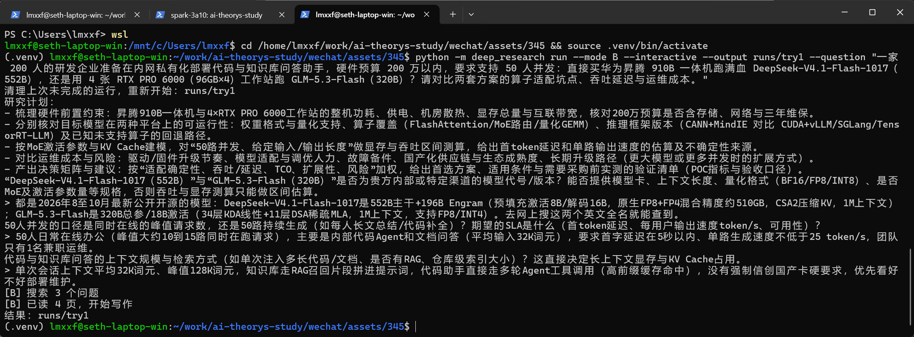

# 硬件选型题：Zero终端实跑与同题对照

2026-10-20，本轮实验换成具体型号、具体负载的私有化部署选型：昇腾910B一体机运行DeepSeek-V4.1-Flash-1017，还是4张96GB RTX PRO 6000运行GLM-5.3-Flash。企业规模200人，硬件预算200万元以内；实际业务口径由Zero在终端回答三次澄清后确定。

[完整对照表](2026-10-20/comparison.md) · [机器可读结果](2026-10-20/comparison.json) · [运行来源与输入哈希](2026-10-20/provenance.json)

## 真实输入从哪里来

输入逐字取自 `runs/try1/state.json`，不是重新编写的示范题：

- [question.txt](question.txt)：原始硬件选型问题。
- [brief.txt](brief.txt)：原始值就是空字符串，因此这个文件也为空，没有替Zero补一份简报。
- [answers.txt](answers.txt)：三条真实问题与回答，保留原始JSON字符串。它们明确了模型规格、并发与SLA，以及上下文/RAG/Agent场景。

关键负载是50人日常在线、峰值约10到15路请求；平均32K、峰值128K上下文；首字低于5秒、单路生成至少25 token/s；只有一名兼职运维，不强制国产卡。两个A均得到全部回答，不用信息更少的A来比较。

题设中的模型参数和配置说明是用户输入，原样保存不等于本项目已做硬件验证；生成报告内的来源、估算与未知项应分别阅读。本轮四组均没有注入额外文风样稿。

## 四组产物

| 运行 | 内容 | 报告 |
|---|---|---|
| A serial-thinking | 同题同简报同回答，全部节点思考、串行执行 | [A思考版](2026-10-20/a-thinking/report.md) |
| A parallel-fast | 同题同简报同回答，并发、非思考 | [A快速版](2026-10-20/a-fast/report.md) |
| B parallel-fast | 直接复制/导出Zero的 `runs/try1`，没有重新生成替代原稿 | [B原始实跑](2026-10-20/b-fast/report.md) |
| B revision-1 | 只把P1改成管理层汇报的三点结论：建议、条件、采购前验证风险 | [局部修订](2026-10-20/b-fast/revision-1/report.md) |

每组目录都有 `metrics.json`、`events.jsonl` 与 `evidence.json`。修订的前后段落与指令另见 `revision.json`，其余五段保持不变。原始 `runs/try1` 完整保留；修订在复制出的运行目录中进行。

终端现场截图也保留在仓库：



## 计时不能把人等答案的时间藏起来

B的原始总墙钟是 **201.23秒**，其中 **159.015秒是等待Zero输入回答**，扣除后自动运行约 **42.216秒**。自动运行仍包含网络、调度与生成，不是纯模型算力时间。

对照表同时列总墙钟、人工等待与自动运行时间。两个A已经预先得到答案，没有交互等待；因此不能拿B的201秒与A的纯自动时间比较，也不能只报42秒而不交代人工参与。

A/B改变了对齐、查询、摘要/证据、补查和写作方式，不是单变量消融。两种A也同时改变思考与并发。搜索结果和缓存命中按实际记录，不保证四组来源相同；B先由Zero运行，之后做修订、再补跑A，表格行顺序不是执行顺序。

## 预算与失败尝试

Zero原始B每次模型输出上限8192。A思考版最初用16384，但最终写作节点触发截断：该次输出16384 tokens中13692为推理token，正文未完成。程序正确记为失败，没有把截断内容当报告。

这次失败耗时156.139秒，共7次模型调用，22575 input、26357 output（含20400 reasoning）。[失败metrics](2026-10-20/attempts/a-thinking-truncated-16384/metrics.json) 与 [失败事件日志](2026-10-20/attempts/a-thinking-truncated-16384/events.jsonl) 单独保留，未算进后来成功运行的耗时，但它确实发生并消耗了额度。

随后两个A统一设为32768输出上限、240秒模型超时、900秒全局期限；B与修订保留原有8192上限。它们不是等预算实验，compare.py会读取各组实际配置并明确列出。Output已经包含Reasoning，不能再相加收费；费用只给当天官方峰谷单价估算区间，不冒充服务端账单。

这里衡量的是研究程序怎样生成报告，不是这两套硬件的实际吞吐测试。星号、引用编号或原文匹配不能替代采购前的POC；本仓库没有运行这两套推理硬件。

## 重跑

按主README配置虚拟环境与.env后：

```bash
bash experiments/run_demo.sh runs/hardware-repeat
```

脚本会把已保存的三条回答直接传给各组，B不再让人重新输入，因此重跑时不会复现原始159秒人工等待。脚本生成的B属于新运行，不要替换后仍声称是Zero那次原始交互。

```bash
python experiments/compare.py runs/hardware-repeat experiments/my-repeat
python -m deep_research export --run-dir runs/hardware-repeat/b-fast --output experiments/my-repeat/b-fast
```

旧的Qwen业务题已从当前公开实验路径移除；历史commit仍可回查，本地还存有忽略目录内的备份。API Key、网页全文和运行缓存不进入公开git；公开产物由export白名单生成。
